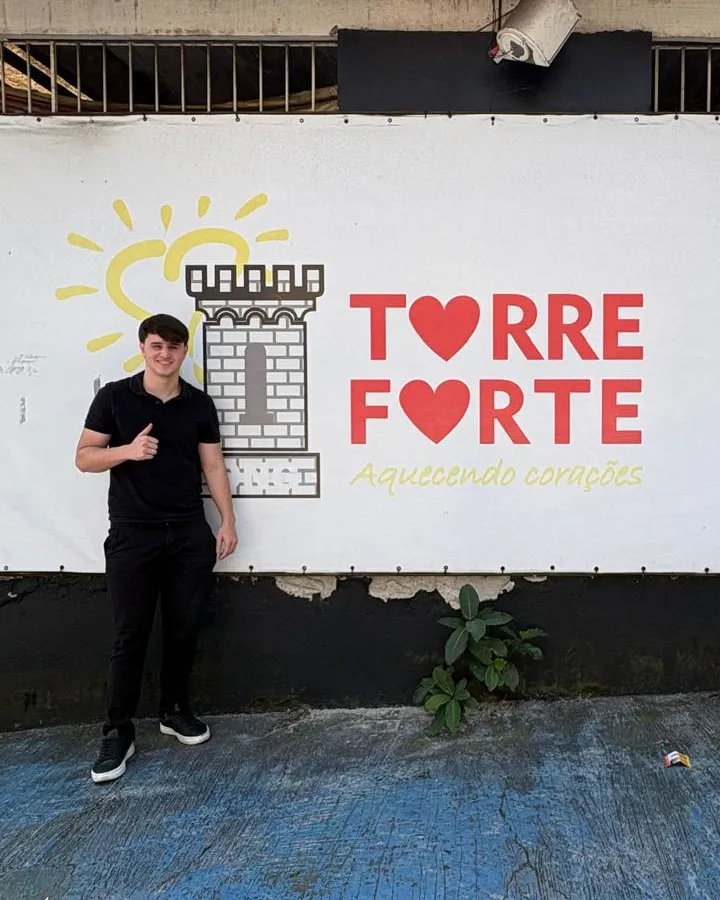

# Imagens — ONG Torre Forte

Planejamento visual das fotografias reais da ONG para o site. Segue `specs/site.md` (estrutura) e `specs/design.md` (identidade).

**Regras desta etapa:** nenhuma imagem gerada, nenhum banco de imagens, nenhuma foto inventada. Os arquivos originais em `imagens-site/` **não foram alterados, renomeados nem movidos**. Os recortes descritos aqui serão exportados como cópias na implementação.

**Materiais analisados:** as 9 fotos de `imagens-site/`, o logo em `marca/` (JPEG e o novo PNG), as referências em `referência - site/`, `CLAUDE.md`, `specs/site.md`, `specs/design.md` e `memoria.md`.

---

## Resumo

- **9 fotos**, todas na **vertical (3:4), com 960×1280 px** (≈1,2 MP) e em JPEG já comprimido (69–211 KB).
- **Consequência técnica:** nenhuma foto aguenta ocupar a largura total da tela em desktop (a 1920 px, ficaria esticada 2× e borrada). Todas as fotos serão exibidas com **no máximo 960 px de largura** em CSS, e o ideal é até ~600 px.
- **Cobertura por projeto:**

| Projeto / tema | Fotos disponíveis |
|----------------|-------------------|
| Pastel Solidário | ✅ 06 e 09 (pastéis visíveis) |
| Campanhas solidárias | ✅ 08 (caixas de biscoitos) |
| Ações comunitárias | ✅ 05 e 04 (e 01, condicional) |
| Jiu-jítsu Solidário | ❌ nenhuma |
| Aulas de música | ❌ nenhuma |
| Fundador (Rodolfo Donetti) | ❌ nenhuma foto identificada como dele |
| Sede / fachada | ✅ 07 |

- **Seleção:** 7 fotos selecionadas, 2 condicionais (dependem de uma decisão sua) e nenhuma descartada.
- **Ajustes ao `design.md` aprovados e aplicados em 2026-10-21** (ver a seção 10): hero do desktop em 4:5, em duas colunas, em vez de 16:9; painel tipográfico para projetos sem foto; limite de 960 px de largura.

---

## 1. Inventário completo

> A descrição se limita ao que aparece na foto. Quando o nome do arquivo sugere um contexto que não dá para ver, isso está indicado. Ninguém é identificado por nome.

### 01 · `ong-torre-forte-acao-comunitaria.jpg.jpeg`
- **Conteúdo:** foto de grupo ao ar livre, com cerca de 14 adultos posando em frente a um caminhão branco e a um caminhão-tanque.
- **Pessoas e elementos:**
  - Parte do grupo veste camisetas e coletes da Torre Forte (brancos, azul e marinho, com o logo); outra parte usa coletes e camisetas de um grupo de motociclistas.
  - Sobre o caminhão há duas bandeiras pretas desse grupo, com caveiras e o nome "Insanos"; uma delas tem a bandeira do Brasil.
  - O caminhão-tanque mostra o nome de uma empresa.
  - Céu azul com nuvens no terço superior; chão de cascalho no terço inferior.
  - Não há crianças.
- **Qualidade:** boa, nítida e bem exposta (brilho médio 129/255). Luz de sol forte e céu saturado.
- **Orientação:** vertical.
- **Recorte:** o grupo ocupa só a faixa central (y ≈ 570–990). O céu é uma área livre grande. As bandeiras com caveiras ficam logo atrás das cabeças e **não dá para tirá-las do quadro** sem cortar pessoas.
- **Seções possíveis:** Quem Somos (onde atuamos), Como Ajudar (empresas e parceiros), Projetos (campanhas).
- **Potencial:** médio. Mostra mobilização coletiva e a camiseta da ONG, mas o protagonismo visual das bandeiras de terceiros, com caveiras, conflita com o tom acolhedor do site.
- **Alertas:** marcas e símbolos de terceiros em destaque; muitas pessoas identificáveis. → **Condicional** (ver a seção 9).

### 02 · `ong-torre-forte-atividades-com-criancas.jpg.jpeg`
- **Conteúdo:** ambiente interno. Uma criança pequena de capuz vermelho, colete azul e calça caramelo, de chinelo, está em pé entre cadeiras dobráveis de madeira e olha para o lado. Uma mulher jovem de moletom azul-marinho, sentada, olha com atenção para ela.
- **Elementos:**
  - Ao fundo há uma máquina de pegar pelúcia, uma escada de alumínio e uma parede coberta de cartazes e grafite.
  - **Um dos cartazes (canto superior direito, x ≈ 664–804, y ≈ 115–310) mostra uma caricatura fazendo um gesto obsceno.**
  - Cadeiras vermelhas com uma marca comercial parcialmente visível ("…EL") e uma placa "Santa Carga".
- **Qualidade:** razoável. É a foto **mais escura** do conjunto (brilho médio 85/255), com leve ruído.
- **Orientação:** vertical (959×1280).
- **Recorte:** obrigatório começar em y ≥ 320 e limitar a largura a x ≤ 768 para eliminar a parede de cartazes. Isso apara ~30 px do topo do capuz e do cabelo, o que é aceitável.
- **Seções possíveis:** Galeria, Projetos (ações comunitárias).
- **Potencial:** médio. Cena de atenção e escuta entre um adulto e uma criança. A criança está séria, olhando para fora do quadro.
- **Alertas:** cartaz impróprio, marcas de terceiros, criança identificável e iluminação baixa. → **Condicional**.

### 03 · `ong-torre-forte-crianca.jpg.jpeg`
- **Conteúdo:** retrato próximo de uma criança pequena de casaco acolchoado escuro, sentada a uma mesa clara, olhando atenta para o lado, com expressão curiosa. Parede de azulejos brancos e um copo vermelho no canto inferior direito.
- **Qualidade:** **excelente**, com foco no rosto, fundo desfocado e luz suave (brilho 151/255). Arquivo leve (69 KB), sem artefatos visíveis.
- **Orientação:** vertical.
- **Recorte:** muito flexível (1:1, 4:5 ou 4:3), com o rosto centralizado em x ≈ 260–650 e y ≈ 230–640.
- **Seções possíveis:** Galeria, Projetos e um destaque emocional.
- **Potencial:** alto, de conexão direta (olhar e rosto). **Cuidado:** a expressão é neutra; não combinar com textos que sugiram fome, tristeza ou carência.
- **Observação:** a mesa e o copo vermelho lembram a foto 09, mas isso **não confirma** que seja o mesmo lugar ou projeto.
- **Alertas:** close de criança identificável, o que exige autorização prioritária.

### 04 · `ong-torre-forte-criancas-atendidas.jpg.jpeg`
- **Conteúdo:** duas crianças em primeiro plano. A da direita sorri amplamente e segura um saquinho plástico com doces; a da esquerda, de moletom branco sobre camiseta rosa com estampa religiosa, olha para a câmera. Uma terceira criança aparece cortada na borda esquerda.
- **Fundo (desfocado):** área externa coberta, com cadeiras empilhadas sobre mesas, cordão de lâmpadas, grafite e uma placa.
- **Qualidade:** muito boa, com foco nos rostos e fundo desfocado (brilho 121/255).
- **Orientação:** vertical.
- **Recorte:** começar em x ≥ 80 elimina a criança cortada na borda. Os rostos ficam em y ≈ 210–650.
- **Seções possíveis:** Galeria, Projetos (ações comunitárias), Crianças atendidas.
- **Potencial:** **muito alto**. É o sorriso mais espontâneo do conjunto: alegria, esperança e as crianças como protagonistas.
- **Contexto:** o nome do arquivo diz "crianças atendidas"; o evento e o projeto não são identificáveis pela imagem.
- **Alertas:** três crianças identificáveis (uma delas sai no recorte).

### 05 · `ong-torre-forte-entrega-de-presentes.jpg.jpeg`
- **Conteúdo:** ao ar livre, sob sol. Um homem de camiseta azul com o logo da Torre Forte serve refrigerante de uma garrafa PET verde em copos plásticos para crianças. Em primeiro plano, uma menina de cabelo cacheado, camiseta rosa e saia florida segura um copo.
- **Ao fundo:** uma fila com um homem de camiseta vermelha segurando um bebê, outras crianças, um muro de tijolos e um carro vermelho.
- **Qualidade:** boa e nítida (brilho 118/255), com sombras duras de sol a pino.
- **Orientação:** vertical.
- **Recorte:** a cabeça do homem começa em y ≈ 70; a garrafa e os copos ficam em y ≈ 640–920. O canto superior direito (céu) é uma área livre.
- **Seções possíveis:** Projetos (ações comunitárias), Quem Somos (onde atuamos), Início (card de projeto).
- **Potencial:** alto. É a ONG em ação, servindo diretamente as crianças, com a camiseta da ONG visível.
- **Alertas:**
  - **O nome do arquivo ("entrega de presentes") não corresponde ao que aparece:** não há presentes visíveis, só a distribuição de bebida.
  - A marca do refrigerante aparece em destaque no centro do quadro.
  - Várias crianças e um bebê identificáveis.

### 06 · `ong-torre-forte-equipe.jpg.jpeg`
- **Conteúdo:** cozinha com azulejos brancos. Duas mulheres de touca descartável sorriem para a câmera, uma de jaqueta preta e outra de blusa preta segurando um saco de papel pardo. À direita, uma bancada com pastéis fritos sobre tábua verde e um tabuleiro com dezenas de pastéis em saquinhos.
- **Ao fundo:** uma terceira mulher de touca olhando o celular, uma pequena imagem religiosa na parede, a geladeira com anotações e a porta.
- **Qualidade:** boa (brilho 124/255), com luz interna um pouco fria.
- **Orientação:** vertical.
- **Recorte:** os rostos ficam em y ≈ 290–470 e os pastéis em y ≈ 850–1280.
- **Seções possíveis:** Projetos (**Pastel Solidário**), Início (card do Pastel), Como Ajudar (voluntariado).
- **Potencial:** alto. Mostra os bastidores do trabalho, com alegria, cuidado e o pastel bem identificável.
- **Contexto:** o nome do arquivo diz "equipe"; não dá para saber se são voluntárias ou funcionárias.
- **Alertas:** adultas identificáveis; uma delas segura um utensílio de cozinha cortante (contexto natural).

### 07 · `ong-torre-forte-fachada.jpg.jpeg`
- **Conteúdo:** um jovem de camisa polo preta faz sinal de positivo ao lado de um grande painel branco na parede, com o **logo da Torre Forte** (torre, sol, coração e "Aquecendo corações"). À direita do painel, um mural com dezenas de fotos impressas.
- **Acima:** telhas onduladas, grade e um refletor. **Abaixo:** piso azul desgastado, uma planta, um papel pequeno no chão (x ≈ 670, y ≈ 940) e galhos secos no canto inferior esquerdo.
- **Qualidade:** boa, com luz do dia (brilho 132/255).
- **Orientação:** vertical.
- **Recorte:**
  - Horizontal 16:9 em y ≈ 270–810: painel inteiro mais a pessoa até a coxa.
  - Vertical 4:5 em x 0–720 e y 180–1080: tira o mural de fotos e os galhos.
- **Seções possíveis:** Início (Quem somos), Quem Somos (abertura), Contato (sede).
- **Potencial:** alto para **credibilidade**: prova a existência de um espaço físico com a marca. É menos forte em emoção.
- **Contexto:** o nome do arquivo diz "fachada". A identidade do jovem não é conhecida (**não presumir que seja o fundador**).
- **Alertas:** o mural contém fotos pequenas de pessoas, com rostos de ~20 px na web e risco baixo. O recorte 4:5 o exclui.

### 08 · `ong-torre-forte-voluntarios.jpg.jpeg`
- **Conteúdo:** ao ar livre, sob sol. Quatro adultos, três mulheres e um homem, sorriem segurando pilhas de caixas de biscoitos e chocolates. Todos vestem camisetas ou coletes da Torre Forte com o logo bem visível.
- **Ao fundo:** um galpão, um baú de caminhão vermelho, carros e uma torre de antena; céu azul com nuvens no topo.
- **Qualidade:** boa e nítida (brilho 121/255), com céu saturado.
- **Orientação:** vertical.
- **Recorte:** rostos em y ≈ 240–520 e caixas em y ≈ 640–950. Os 230 px de céu no topo são uma área livre.
- **Seções possíveis:** Projetos (**Campanhas solidárias**), Como Ajudar (doação de itens), Início (card de campanhas), Voluntariado.
- **Potencial:** alto. Mostra doação concreta e equipe uniformizada, o que passa organização e confiança.
- **Contexto:** o nome do arquivo diz "voluntários". O homem de camiseta azul parece ser a mesma pessoa das fotos 01 e 05, e o pátio de cascalho lembra o da foto 01. É uma hipótese, não confirmada.
- **Alertas:** adultos identificáveis; marcas de produtos visíveis nas embalagens (risco baixo).

### 09 · `ong-torre-forte-voluntário.jpg.jpeg`
- **Conteúdo:** um homem de óculos, touca descartável e avental branco da Torre Forte (logo completo visível) sorri sentado a uma mesa entre duas crianças pequenas. A criança da esquerda segura um pastel; a da direita come um pedaço. Há copos vermelhos sobre a mesa.
- **Ao fundo:** parede clara com pintura de um leão, uma pessoa de colete da Torre Forte (de costas) e uma senhora.
- **Qualidade:** **excelente**, nítida, a foto mais clara do conjunto (brilho 164/255), com cores vivas (vermelho dos copos e do logo).
- **Orientação:** vertical.
- **Recorte:** muito flexível. O homem fica em y ≈ 130–400; as crianças em y ≈ 450–690 (rostos) e 700–880 (pastel). A metade inferior é mesa lisa.
- **Seções possíveis:** **Hero**, Projetos (Pastel Solidário), Como Ajudar (voluntariado), Open Graph.
- **Potencial:** **o maior do conjunto.**
  - Reúne cuidado, gerações diferentes, alimentação, crianças e a marca da ONG numa só imagem.
  - Traduz o slogan "Aquecendo corações".
- **Contexto:** o nome do arquivo diz "voluntário".
- **Alertas:** duas crianças pequenas identificáveis e adultos ao fundo.

---

## 2. Seleção

| # | Foto | Status | Motivo |
|---|------|--------|--------|
| 09 | Voluntário com crianças e pastel | ✅ **Selecionada (protagonista)** | Melhor equilíbrio entre emoção, marca e projeto |
| 04 | Crianças sorrindo com doces | ✅ Selecionada | Alegria espontânea; crianças como protagonistas |
| 06 | Equipe na cozinha com pastéis | ✅ Selecionada | Única foto que mostra a produção do Pastel Solidário |
| 08 | Voluntários com caixas de doação | ✅ Selecionada | Ilustra doação de itens e a equipe uniformizada |
| 05 | Servindo crianças ao ar livre | ✅ Selecionada | A ONG em ação na comunidade |
| 03 | Retrato de criança | ✅ Selecionada | Melhor qualidade técnica e conexão pelo olhar |
| 07 | Fachada com o painel da ONG | ✅ Selecionada | Credibilidade: espaço físico e marca |
| 01 | Grupo com bandeiras de motociclistas | ⚠️ **Condicional** | Depende de decisão institucional sobre as marcas e símbolos de terceiros |
| 02 | Criança e adulta, ambiente interno | ⚠️ **Condicional** | Exige recorte para remover o cartaz impróprio; foto escura e com marcas de terceiros |

---

## 3. Distribuição por seção

### Visão geral por tema

| Tema | Foto(s) |
|------|---------|
| Hero principal | **09** |
| Apresentação da ONG | 07 |
| História e propósito | sem foto do fundador → layout tipográfico |
| Missão e impacto social | sem foto → faixa grafite com números e tijolos |
| Projetos e atividades | 06, 09, 08, 05, 04 (+ 01 e 02, condicionais) |
| Crianças e famílias atendidas | 04, 03, 05, 09 |
| Voluntariado | 09, 06, 08 |
| Galeria | 04, 03 (+ 02 e 01, condicionais) e um bloco tipográfico |
| Doações e formas de ajudar | 08 (itens); Pix sem foto |
| CTAs | sem foto → blocos tipográficos (o hero já leva CTA sobre a 09) |
| Rodapé | sem foto (só o logo) |

### Início (`index.html`)

| Seção | Foto | Recorte | Observação |
|-------|------|---------|------------|
| 1. Hero | **09** | 4:5 | Duas colunas no desktop; foto acima do texto no celular |
| 2. Três caminhos de ajuda | — | — | Cards com ícone, conforme o design.md |
| 3. Quem somos (resumo) | **07** | 16:9 (desktop) / 4:5 (celular) | Credibilidade logo após a emoção do hero |
| 4. Projetos em destaque | 06 · ▢ · ▢ · 08 · 05 | 4:3 | Pastel = 06; Jiu-jítsu e Música = **painel tipográfico** (sem fotos); Campanhas = 08; Ações = 05 |
| 5. Impacto | — | — | Faixa grafite, números e motivo de tijolos |
| 6. Ciclo da solidariedade | — | — | **Sem foto de propósito**: usar fotos de adultos para ilustrar "crianças que cresceram e transformaram vidas" seria atribuir uma história não documentada |
| 7. Galeria | 04 · 03 · bloco "Aquecendo corações" (+ 02 e 01, se aprovadas) | 4:5 (desktop) / 1:1 (celular) | Nenhuma foto repetida na mesma página |
| 8. Depoimentos | — | — | Oculta até haver depoimentos reais |
| 9. CTA final (Pix) | — | — | Bloco tipográfico em amarelo ou grafite, com o slogan |

### Quem Somos (`quem-somos.html`)

| Seção | Foto | Recorte | Observação |
|-------|------|---------|------------|
| 1. Abertura | **07** | 4:5 | Recorte vertical, sem o mural de fotos |
| 2. Nossa história | — | — | Citação grande e texto, com `[FOTO: Rodolfo Donetti — pendente]` só se a ONG for enviar a foto |
| 3. Missão, visão e valores | — | — | Três blocos tipográficos com o motivo de tijolos |
| 4. Onde atuamos | **05** (alternativa: 01, se aprovada) | 3:2 | Comunidade ao ar livre |
| 5. Transparência | — | — | Só texto e dados |
| 6. CTA | — | — | Tipográfico |

### Projetos (`projetos.html`)

| Projeto | Foto principal | Foto(s) secundária(s) | Observação |
|---------|----------------|-----------------------|------------|
| Pastel Solidário | **06** (4:5) | **09** (1:1) | 03 só se a ONG confirmar que é do Pastel |
| Jiu-jítsu Solidário | painel tipográfico (4:5) | — | Pendência de fotos |
| Aulas de música | painel tipográfico (4:5) | — | Pendência de fotos |
| Campanhas solidárias | **08** (4:5) | 01 (4:3), se aprovada | — |
| Ações comunitárias | **05** (4:5) | **04** (1:1); 02 (1:1), se aprovada | — |

> ⚠️ A ligação de cada foto a um projeto foi feita **pelo conteúdo visível** (pastéis = Pastel Solidário; caixas de alimentos = Campanhas; distribuição ao ar livre = Ações comunitárias). **Precisa ser confirmada pela ONG.**

### Como Ajudar (`como-ajudar.html`)

| Seção | Foto | Recorte | Observação |
|-------|------|---------|------------|
| 1. Introdução | — | — | Tipográfica |
| 2. Doe via Pix | — | — | Card amarelo com QR Code; foto aqui competiria com o QR |
| 3. Doe alimentos, roupas e materiais | **08** | 4:3 | Doação concreta |
| 4. Seja voluntário | **09** | 4:3 | Mostra o que o voluntário vive: estar com as crianças |
| 5. Empresas parceiras | — | — | Tipográfico; logos de parceiros pendentes |
| 6. Perguntas frequentes | — | — | — |

### Contato (`contato.html`)

| Seção | Foto | Recorte | Observação |
|-------|------|---------|------------|
| Endereço | **07** (pequena) | 16:9 | Só se o endereço for público |

### Todas as páginas
- **Cabeçalho e rodapé:** sem fotos, apenas o logo (ver a pendência do logo na seção 9).
- **Open Graph (compartilhamento):** uma composição de 1200×630 com a foto 09 em 1:1 (630×630) à esquerda e o logo sobre fundo branco à direita. É montagem de layout, sem alterar a foto.

### Soluções para seções sem foto adequada

- **Painel tipográfico de projeto** (Jiu-jítsu e Música), na mesma proporção da foto que substitui (4:3 nos cards e 4:5 nos blocos), para manter a consistência da grade:
  - fundo `--cor-areia` com o motivo de tijolos em `--cor-tijolo` a 25% de opacidade;
  - ícone do projeto em 64–96 px, traço de 2 px em grafite, centralizado;
  - nome do projeto em Bricolage 700.
  - **Os dois painéis usam exatamente o mesmo tratamento.** É um elemento de design acabado, não um "aguardando foto". Substituir quando as fotos chegarem.
- **Ciclo da solidariedade, Impacto e CTAs:** tipografia grande, cores da marca e motivos do logo (tijolos, coração e raios de sol, um por bloco).
- **Nossa história:** citação em display e espaço em branco generoso.

---

## 4. Fichas técnicas das imagens selecionadas

> Coordenadas em pixels do original 960×1280 (x, y, largura, altura), aproximadas, conferidas em prévia. Os recortes são **exportados como arquivos próprios** (direção de arte via `<picture>`); `object-position` é só para ajuste fino.

### Ficha 09 — Voluntário com crianças e pastel ★

| Campo | Definição |
|-------|-----------|
| Nome original | `ong-torre-forte-voluntário.jpg.jpeg` |
| Nome recomendado | `pastel-solidario-voluntario-com-criancas` |
| Seções | Início/Hero · Projetos/Pastel (secundária) · Como Ajudar/Voluntário · Open Graph |
| Objetivo | Criar a conexão emocional imediata e mostrar a ONG em ação, com a marca visível |
| Descrição | Voluntário de touca e avental da ONG sorri entre duas crianças pequenas que comem pastel |
| Enquadramento | Plano médio com os três rostos e o logo do avental; manter o pastel da criança da esquerda |
| Proporção ideal | **4:5** (hero) · 1:1 (Projetos, OG) · 4:3 (Como Ajudar) |
| Recorte | 4:5 → `0, 40, 960, 1200` · 1:1 → `0, 90, 960, 960` · 4:3 → `0, 110, 960, 720` |
| Posicionamento | Hero: coluna direita (5 de 12 colunas) com o texto à esquerda · Como Ajudar: ao lado do texto |
| Área livre para texto | Nenhuma adequada (foto clara, parede branca). **Não sobrepor texto** |
| Tratamento | Temperatura +3 (luz interna levemente fria); realces −10 para segurar a parede branca. Nada além disso |
| Desktop | Hero: 4:5, ~480–520 px de largura, raio 16 px; raios de sol amarelos opcionais atrás do canto superior esquerdo, sem tocar nos rostos. `object-position: 50% 30%` |
| Celular | Hero: 4:5 em largura total (menos as margens de 16 px), **acima** do título; carregada com prioridade (LCP) |
| Alt | "Voluntário da Torre Forte, de touca e avental da ONG, sorri sentado à mesa entre duas crianças pequenas que comem pastel." |

### Ficha 06 — Equipe na cozinha com pastéis

| Campo | Definição |
|-------|-----------|
| Nome original | `ong-torre-forte-equipe.jpg.jpeg` |
| Nome recomendado | `pastel-solidario-equipe-cozinha` |
| Seções | Início/card Pastel Solidário · Projetos/Pastel (principal) |
| Objetivo | Mostrar o Pastel Solidário sendo feito: trabalho real, alegria e cuidado |
| Descrição | Duas integrantes da equipe, de touca, sorriem na cozinha ao lado de bandejas de pastéis |
| Enquadramento | As duas integrantes da cintura para cima, com a tábua de pastéis à direita |
| Proporção ideal | 4:3 (card) · 4:5 (bloco do projeto) |
| Recorte | 4:3 → `0, 250, 960, 720` · 4:5 → `0, 80, 960, 1200` |
| Posicionamento | Card: foto no topo · Projetos: coluna da foto, alternando lado com os outros projetos |
| Área livre para texto | Nenhuma. Não sobrepor |
| Tratamento | Temperatura +4 (luz fluorescente); contraste +5 |
| Desktop | Card 4:3 com ~360 px de largura; bloco 4:5 com ~480 px. `object-position: 50% 45%` no card |
| Celular | Card em largura total, 4:3 |
| Alt | "Duas integrantes da equipe da Torre Forte, de touca descartável, sorriem na cozinha ao lado de bandejas com pastéis fritos." |

### Ficha 08 — Voluntários com caixas de doação

| Campo | Definição |
|-------|-----------|
| Nome original | `ong-torre-forte-voluntarios.jpg.jpeg` |
| Nome recomendado | `campanha-voluntarios-doacao-alimentos` |
| Seções | Início/card Campanhas · Projetos/Campanhas (principal) · Como Ajudar/Doe itens |
| Objetivo | Mostrar a doação concreta virando ação; equipe uniformizada passa organização |
| Descrição | Quatro voluntários com camisetas da ONG seguram pilhas de caixas de biscoitos ao ar livre |
| Enquadramento | Os quatro do peito para cima com as caixas inteiras; cortar a maior parte do céu e do chão |
| Proporção ideal | 4:3 (card e Como Ajudar) · 4:5 (Projetos) |
| Recorte | 4:3 → `0, 220, 960, 720` · 4:5 → `0, 40, 960, 1200` |
| Posicionamento | Card: foto no topo · Como Ajudar: ao lado do texto "Doe alimentos…" |
| Área livre para texto | O céu no topo (y 0–230) **só na versão 4:5**; mesmo assim, preferir não sobrepor |
| Tratamento | Saturação −5 só nos azuis (céu); sombras +10 nos rostos |
| Desktop | Card 4:3; `object-position: 50% 40%` |
| Celular | 4:3 em largura total |
| Alt | "Quatro voluntários com camisetas da Torre Forte seguram pilhas de caixas de biscoitos em um pátio ao ar livre." |

### Ficha 05 — Servindo crianças ao ar livre

| Campo | Definição |
|-------|-----------|
| Nome original | `ong-torre-forte-entrega-de-presentes.jpg.jpeg` |
| Nome recomendado | `acao-comunitaria-servindo-criancas` (**não** "entrega de presentes", que não aparece na foto) |
| Seções | Início/card Ações comunitárias · Projetos/Ações (principal) · Quem Somos/Onde atuamos |
| Objetivo | Mostrar a ONG presente na comunidade, atendendo diretamente as crianças |
| Descrição | Integrante da ONG serve bebida em copos para crianças em uma fila ao ar livre |
| Enquadramento | O homem à esquerda e a menina à direita; manter a cabeça dele inteira (o topo está em y ≈ 70) |
| Proporção ideal | 4:3 (card) · 4:5 (Projetos) · 3:2 (Quem Somos) |
| Recorte | 4:3 → `0, 80, 960, 720` · 4:5 → `0, 0, 960, 1200` · 3:2 → `0, 60, 960, 640` |
| Posicionamento | Card: foto no topo · Quem Somos: meia coluna ao lado do texto "Onde atuamos" |
| Área livre para texto | Céu no canto superior direito (pequeno). Não sobrepor |
| Tratamento | Sombras +10 (rosto do homem sob sol a pino); saturação −5 nos azuis |
| Desktop | `object-position: 50% 15%` no card |
| Celular | 4:3 em largura total; conferir se o rosto da menina não fica cortado na borda direita |
| Alt | "Integrante da Torre Forte, de camiseta azul da ONG, serve bebida em copos plásticos para crianças em fila ao ar livre." |

### Ficha 04 — Crianças sorrindo com doces

| Campo | Definição |
|-------|-----------|
| Nome original | `ong-torre-forte-criancas-atendidas.jpg.jpeg` |
| Nome recomendado | `criancas-sorrindo-com-doces` |
| Seções | Início/Galeria (destaque) · Projetos/Ações comunitárias (secundária) |
| Objetivo | Esperança e alegria: as crianças como protagonistas |
| Descrição | Duas crianças olham para a câmera; a da frente sorri e segura um saquinho de doces |
| Enquadramento | As duas crianças com o saquinho; **excluir a terceira criança cortada na borda esquerda** |
| Proporção ideal | 4:5 (galeria desktop) · 1:1 (galeria celular e Projetos) |
| Recorte | 4:5 → `80, 140, 880, 1100` · 1:1 → `80, 200, 880, 880` |
| Posicionamento | Galeria: primeiro item (maior destaque) |
| Área livre para texto | Nenhuma. Não sobrepor |
| Tratamento | Nenhum além da normalização geral (seção 5) |
| Desktop | Galeria 4:5 com ~380 px |
| Celular | 1:1 na grade de 2 colunas ou em largura total como primeiro item |
| Alt | "Duas crianças sorriem para a câmera; a da frente segura um saquinho com doces." |

### Ficha 03 — Retrato de criança

| Campo | Definição |
|-------|-----------|
| Nome original | `ong-torre-forte-crianca.jpg.jpeg` |
| Nome recomendado | `crianca-retrato-a-mesa` |
| Seções | Início/Galeria · (Projetos/Pastel, só se a ONG confirmar) |
| Objetivo | Conexão pelo olhar; dar rosto a quem a ONG atende, com dignidade |
| Descrição | Criança pequena de casaco escuro, sentada à mesa, olha atenta para o lado |
| Enquadramento | Rosto no terço superior, com a borda da mesa na base |
| Proporção ideal | 4:5 (galeria desktop) · 1:1 (galeria celular) |
| Recorte | 4:5 → `0, 40, 960, 1200` · 1:1 → `0, 100, 960, 960` |
| Posicionamento | Galeria: segundo item |
| Área livre para texto | Azulejos claros acima da cabeça, mas **não usar**: texto sobre o retrato de uma criança desvia o foco |
| Tratamento | Nenhum (já é a melhor foto do conjunto) |
| Desktop | 4:5 com ~380 px |
| Celular | 1:1 |
| Alt | "Criança pequena de casaco escuro, sentada à mesa, olha atenta para o lado." |

### Ficha 07 — Fachada com o painel da ONG

| Campo | Definição |
|-------|-----------|
| Nome original | `ong-torre-forte-fachada.jpg.jpeg` |
| Nome recomendado | `sede-fachada-painel-torre-forte` |
| Seções | Início/Quem somos (resumo) · Quem Somos/Abertura · Contato/Endereço (se for público) |
| Objetivo | Credibilidade: a ONG tem um espaço físico e uma identidade |
| Descrição | Jovem faz sinal de positivo ao lado do painel com o logo da Torre Forte na fachada |
| Enquadramento | 16:9 com o painel inteiro (logo e mural); 4:5 com o logo e a pessoa, sem o mural |
| Proporção ideal | 16:9 (desktop, Início e Contato) · 4:5 (celular e Quem Somos) |
| Recorte | 16:9 → `0, 270, 960, 540` · 4:5 → `0, 180, 720, 900` |
| Posicionamento | Início: coluna ao lado do texto de resumo · Quem Somos: coluna direita da abertura |
| Área livre para texto | O painel branco tem áreas vazias, mas **não sobrepor**: competiria com o logo |
| Tratamento | Realces −10 (painel branco); sem mexer nas cores do logo |
| Desktop | 16:9 com ~560 px de largura |
| Celular | 4:5 em largura total |
| Alt | "Jovem faz sinal de positivo ao lado de um painel com o logo da Torre Forte na fachada da ONG." |

### Ficha 01 — Grupo com bandeiras de motociclistas ⚠️ condicional

| Campo | Definição |
|-------|-----------|
| Nome original | `ong-torre-forte-acao-comunitaria.jpg.jpeg` |
| Nome recomendado | `acao-comunitaria-grupo` |
| Seções (se aprovada) | Projetos/Campanhas (secundária) · Quem Somos/Onde atuamos (alternativa) · Galeria |
| Objetivo | Mostrar a mobilização coletiva |
| Descrição | Voluntários da Torre Forte e integrantes de um grupo de motociclistas posam em frente a um caminhão |
| Enquadramento | Grupo inteiro com parte das bandeiras; não dá para excluir as caveiras sem cortar pessoas |
| Proporção ideal | 4:3 |
| Recorte | 4:3 → `0, 330, 960, 720` |
| Área livre para texto | Céu (y 0–330), só em versão vertical; não recomendado |
| Tratamento | Saturação −5 nos azuis |
| Desktop / Celular | 4:3 em ambos |
| Alt | "Voluntários da Torre Forte e integrantes de um grupo de motociclistas posam juntos ao ar livre em frente a um caminhão." |

### Ficha 02 — Criança e adulta em ambiente interno ⚠️ condicional

| Campo | Definição |
|-------|-----------|
| Nome original | `ong-torre-forte-atividades-com-criancas.jpg.jpeg` |
| Nome recomendado | `crianca-acompanhada-por-adulta` |
| Seções (se aprovada) | Galeria · Projetos/Ações comunitárias (secundária) |
| Objetivo | Atenção e escuta entre adulto e criança |
| Descrição | Uma mulher sentada observa com atenção uma criança pequena de capuz vermelho em pé ao seu lado |
| Enquadramento | **Recorte obrigatório** para eliminar o cartaz com gesto obsceno e a parede de cartazes |
| Proporção ideal | 4:5 · 1:1 |
| Recorte | 4:5 → `0, 320, 768, 960` · 1:1 → `0, 320, 768, 768` (nunca usar a foto inteira) |
| Área livre para texto | Nenhuma |
| Tratamento | Exposição +0,3 EV, sombras +15 e redução de ruído leve (é a foto mais escura) |
| Desktop / Celular | Galeria 4:5 / 1:1 |
| Alt | "Uma mulher sentada observa com atenção uma criança pequena de capuz vermelho, em pé ao seu lado." |

---

## 5. Direção de arte e consistência

### Harmonia com a paleta
- As fotos já conversam com a marca: **vermelho** (copos, logo do avental e do painel), **azul** das camisetas da ONG e **céu**, **amarelo** (pastéis e sol).
- Coloque as fotos sobre fundo `--cor-creme` ou `--cor-areia`. Em seções grafite, só fotos de fundo claro (09, 03 e 07) para não "afundar".
- Não aplique duotone, filtros de cor da marca nem sobreposições coloridas nas fotos.

### Normalização (o mesmo "preset" leve em todas)
- Balanço de branco neutro levemente quente (+3 a +5), para unificar a luz fria das cozinhas (06, 09 e 03) com o sol forte (01, 05 e 08).
- Contraste entre −5 e +5; saturação geral no máximo +5; nos azuis do céu, −5.
- Realces −10 onde há parede ou painel branco (09 e 07); sombras +10 a +15 em rostos sob sol duro (05 e 08) e na foto escura (02).
- **Proibido:** retoque de pele, afinar ou alterar rostos e corpos, remover pessoas, objetos ou marcas com clonagem ou IA, vinheta, HDR, desfoque artificial e filtros de rede social. **Só recorte e ajustes globais de luz e cor.**

### Contraste para texto sobre imagem
- **Regra padrão: nada de texto sobre as fotos.** O layout em duas colunas no desktop e a foto acima do texto no celular resolvem a legibilidade sem cobrir as pessoas.
- Exceção futura, se uma foto horizontal de alta resolução for enviada: gradiente `linear-gradient(to top, rgba(31,31,33,.6) 0%, rgba(31,31,33,0) 60%)`, texto creme com no mínimo 24 px em negrito, e contraste conferido no ponto mais claro sob o texto (mínimo de 3:1 para texto grande).
- Rótulos sobre fotos (ex.: "Esporte" no card) ficam em uma etiqueta com fundo sólido (branco ou grafite), nunca soltos sobre a imagem.

### Recortes que valorizam as pessoas
- Rostos fora das bordas, com respiro mínimo de 8% da largura entre o rosto e a borda.
- Olhar e direção do corpo voltados para dentro da página: no hero, a foto 09 fica à direita e o texto à esquerda.
- Manter mãos e objetos que contam a história (pastel, caixas, copos).
- Nada de cortar crianças na altura do pescoço ou mostrar só partes do corpo.
- Crianças nunca em recortes que enfatizem chinelos, roupas ou ambiente como sinal de carência.

### Imagem × espaço em branco e ritmo
- **No máximo uma foto de destaque por seção.** Seções com foto se alternam com seções tipográficas (impacto, ciclo e CTA), seguindo o ritmo claro/escuro aprovado.
- Sequência da Início: foto (hero) → tipografia (caminhos) → foto (quem somos) → grade de fotos (projetos) → tipografia escura (impacto e ciclo) → fotos (galeria) → tipografia (CTA).
- Mesma foto nunca aparece duas vezes na mesma página. Entre páginas, a repetição é aceita enquanto houver só 9 fotos (a 09 aparece em 3 páginas; rodiziar quando chegarem fotos novas).
- Raio de 16 px em todas as fotos soltas e cards; sombra única do design.md só nos cards, nunca em fotos soltas.

---

## 6. Adaptações para desktop e celular

### Limite de resolução
- Fonte máxima de **960 px** de largura, o que equivale a ~480 px nítidos em telas retina (2×).
- **Larguras máximas em CSS:**
  - hero e blocos 4:5: 520 px;
  - cards: 400 px;
  - fachada 16:9: 600 px;
  - nunca mais que 960 px.
- Nenhuma foto em largura total no desktop, nem como fundo de seção.

### Direção de arte por breakpoint

| Uso | < 768 px | 768–1023 px | ≥ 1024 px |
|-----|----------|-------------|-----------|
| Hero (09) | 4:5, largura total, acima do texto | 4:5, coluna de 50% | 4:5, 5 de 12 colunas, à direita |
| Quem somos (07) | 4:5 | 4:5 | **16:9** ao lado do texto |
| Cards de projeto | 4:3, 1 por linha | 4:3, 2 por linha | 4:3, 3 por linha (a quinta linha centraliza 2) |
| Blocos de projeto (Projetos) | 4:5 acima do texto | 4:5 ao lado do texto | 4:5 ao lado, alternando esquerda e direita |
| Galeria (04, 03 e bloco) | 1:1, grade de 2 colunas (04 em largura total) | 4:5, 3 colunas | 4:5, 3 colunas |
| Como Ajudar (08 e 09) | 4:3 acima do texto | 4:3 ao lado | 4:3 ao lado |

### Ajuste fino com CSS
Exemplo de referência para a implementação (não é código do site):

```html
<picture>
  <source media="(min-width: 1024px)" srcset="assets/img/fotos/sede-fachada-painel-torre-forte-16x9-960.webp 960w, assets/img/fotos/sede-fachada-painel-torre-forte-16x9-480.webp 480w" sizes="(min-width: 1024px) 560px">
  
</picture>
```

- Todas as imagens com `object-fit: cover` e `aspect-ratio` fixado no contêiner, para que o layout não pule (CLS).
- `object-position` de referência:

| Foto | Valor |
|------|-------|
| 09 | `50% 30%` |
| 06 | `50% 45%` |
| 08 | `50% 40%` |
| 05 | `50% 15%` |
| 04 | `60% 35%` |
| 03 | `50% 30%` |
| 07 (16:9) | `50% 36%` |

---

## 7. Otimização

- **Formato:** WebP com qualidade de 75–80 (os originais já são JPEG comprimidos; abaixo de 75 aparecem artefatos de compressão dupla). AVIF (qualidade ~50) opcional, via `<source type="image/avif">`.
- **Larguras exportadas:** 480, 768 e 960 px, **sem nunca ampliar** (recortes mais estreitos param na própria largura: 04 em 880 px, 07 4:5 em 720 px, 02 em 768 px).
- **Metas de peso:** ≤ 120 KB a 960 px, ≤ 80 KB a 768 px e ≤ 40 KB a 480 px. A Início deve somar ~500 KB de fotos, dentro do limite de 1,5 MB por página.
- **Metadados:** remover todos (EXIF/GPS) na exportação; os arquivos atuais não têm data EXIF, mas isso deve ser garantido.
- **Carregamento:**
  - Hero 09: `fetchpriority="high"`, sem `loading="lazy"` e com `<link rel="preload" as="image" imagesrcset=… imagesizes=…>`.
  - Demais fotos: `loading="lazy"` e `decoding="async"`.
  - Sempre declarar `width` e `height`.
  - Contêiner com fundo `--cor-areia` enquanto a foto carrega.
- **Ferramenta sugerida:** Squoosh (squoosh.app), que roda no navegador sem enviar as fotos a servidores, ou `cwebp` na linha de comando. A exportação é feita uma vez, fora do site.
- **Pasta de destino:** `assets/img/fotos/`. Os originais continuam intactos em `imagens-site/`.

---

## 8. Mapeamento de nomes

Padrão: `{nome-base}-{proporção}-{largura}.webp`, em minúsculas, sem acentos e com hífens.

| # | Arquivo original | Nome-base final | Variantes a exportar |
|---|------------------|-----------------|----------------------|
| 09 | `ong-torre-forte-voluntário.jpg.jpeg` | `pastel-solidario-voluntario-com-criancas` | `-4x5-{480,768,960}` · `-1x1-{480,960}` · `-4x3-{480,768,960}` |
| 06 | `ong-torre-forte-equipe.jpg.jpeg` | `pastel-solidario-equipe-cozinha` | `-4x3-{480,768,960}` · `-4x5-{480,768,960}` |
| 08 | `ong-torre-forte-voluntarios.jpg.jpeg` | `campanha-voluntarios-doacao-alimentos` | `-4x3-{480,768,960}` · `-4x5-{480,768,960}` |
| 05 | `ong-torre-forte-entrega-de-presentes.jpg.jpeg` | `acao-comunitaria-servindo-criancas` | `-4x3-{480,768,960}` · `-4x5-{480,768,960}` · `-3x2-{480,960}` |
| 04 | `ong-torre-forte-criancas-atendidas.jpg.jpeg` | `criancas-sorrindo-com-doces` | `-4x5-{480,880}` · `-1x1-{480,880}` |
| 03 | `ong-torre-forte-crianca.jpg.jpeg` | `crianca-retrato-a-mesa` | `-4x5-{480,960}` · `-1x1-{480,960}` |
| 07 | `ong-torre-forte-fachada.jpg.jpeg` | `sede-fachada-painel-torre-forte` | `-16x9-{480,960}` · `-4x5-{480,720}` |
| 01 ⚠️ | `ong-torre-forte-acao-comunitaria.jpg.jpeg` | `acao-comunitaria-grupo` | `-4x3-{480,960}` (só se aprovada) |
| 02 ⚠️ | `ong-torre-forte-atividades-com-criancas.jpg.jpeg` | `crianca-acompanhada-por-adulta` | `-4x5-{480,768}` · `-1x1-{480,768}` (só se aprovada) |
| — | composição Open Graph (09 + logo) | `og-torre-forte` | `1200x630.jpg` (JPEG por compatibilidade com redes sociais) |

Observações sobre os nomes originais:
- Todos têm **extensão dupla** (`.jpg.jpeg`).
- O arquivo 09 tem **acento** (`voluntário`) e quase o mesmo nome do 08 (`voluntarios`).
- Os nomes finais resolvem isso. **Nada foi renomeado ainda.**

---

## 9. Cuidados com imagens de crianças e pendências

### Princípios aplicados
- Nenhuma criança é identificada por nome, idade exata, escola ou endereço, nem em `alt`, legenda ou nome de arquivo.
- Nenhuma história pessoal é atribuída a pessoas das fotos. Textos ao lado das fotos falam do **projeto**, não da criança retratada.
- Recortes nunca enfatizam carência (roupas, chinelos, ambiente) nem mostram crianças de forma vulnerável.
- A expressão neutra de uma criança (03 e 09) nunca é combinada com frases de tristeza, fome ou pedido de pena.
- O gênero das crianças não é presumido nos textos alternativos.

### Autorização de uso de imagem

| # | Crianças identificáveis | Adultos identificáveis | Terceiros e marcas | Prioridade |
|---|-------------------------|------------------------|--------------------|------------|
| 03 | 1 (close de rosto) | — | — | 🔴 **Alta** |
| 04 | 2 (+1 que sai no recorte) | — | — | 🔴 **Alta** |
| 09 | 2 | 1 + 2 ao fundo | — | 🔴 **Alta** (hero) |
| 05 | Várias + 1 bebê | 2 ou mais | Marca de refrigerante em destaque | 🔴 **Alta** |
| 02 ⚠️ | 1 | 1 | Cartaz impróprio, marcas parciais | 🔴 **Alta** + decisão |
| 06 | — | 3 | — | 🟡 Média |
| 08 | — | 4 | Marcas de produtos | 🟡 Média |
| 07 | — | 1 (+ mural com fotos pequenas) | — | 🟡 Média |
| 01 ⚠️ | — | ~14 | Bandeiras de grupo de motociclistas com caveiras; empresa no caminhão | 🟡 Média + decisão |

**Ação necessária:** a ONG precisa confirmar que tem autorização dos **responsáveis legais** de cada criança e o consentimento dos adultos retratados para o uso **no site**. Enquanto isso não acontecer, as fotos com crianças entram no desenvolvimento, mas **não vão ao ar**.

### Pendências de decisão
1. **Foto 01:** usar ou não, dado o destaque das bandeiras do grupo de motociclistas (com caveiras) e a necessidade de consentimento do grupo para expor sua marca.
2. **Foto 02:** usar ou não, sempre recortada (o cartaz obsceno sai do quadro, mas a foto continua escura e com marcas de terceiros).
3. **Classificação por projeto:** confirmar a qual projeto pertence cada foto (especialmente 03, 04 e 05) e o contexto da foto 05, cujo nome diz "entrega de presentes", mas que mostra distribuição de bebida.
4. **Pessoas:** informar se alguma das pessoas fotografadas é **Rodolfo Donetti** (para a página Quem Somos), sempre com o consentimento dele para aparecer identificado.
5. ~~Ajuste no `design.md`~~ → aprovado e aplicado em 2026-10-21 (ver a seção 10).

### Pendências de material e qualidade
- **Jiu-jítsu Solidário e Aulas de música:** nenhuma foto. São prioridade, porque dois dos cinco projetos ficam só com painel tipográfico.
- **Foto do fundador**, para a seção "Nossa história".
- **Originais em resolução maior:** as fotos parecem ter sido reduzidas (960×1280). Se existirem os arquivos originais do celular (normalmente 3000 px ou mais), envie-os, para permitir uso maior e mais nítido.
- **Fotos horizontais:** todas as atuais são verticais. Uma ou duas fotos horizontais de boa resolução permitiriam faixas mais largas no futuro.
- **Mais fotos de crianças em atividade** (brincando, treinando, tocando), para a galeria crescer sem repetir imagens.
- **Logo (fora das fotos, mas afeta cabeçalho e rodapé):**
  - O novo arquivo `marca/Torre Forte_ Aquecendo Corações.png` (1621×970) tem **fundo preto sólido, sem transparência**. Se for usado sobre o grafite `#1F1F21`, aparece uma caixa preta visível.
  - O vermelho dele (`#F20317`) é **diferente** do vermelho do JPEG (`#D0010C`) usado na paleta.
  - É preciso confirmar qual é o vermelho oficial e conseguir uma versão com fundo transparente (PNG ou SVG).

---

## 10. Ajustes ao `design.md` (aprovados em 2026-10-21)

Os três ajustes abaixo nasceram da análise das fotos e foram **aprovados e aplicados** ao `design.md` (seções 10, 13 e 14):

1. **Hero no desktop:** hoje está definido como "16:9 no desktop". Proposta: **foto 4:5 em duas colunas** (texto à esquerda, foto à direita). Motivo: todas as fotos são verticais com 960 px de largura; uma faixa 16:9 em largura total ficaria borrada e cortaria as pessoas.
2. **Placeholders `[FOTO: …]`:** para Jiu-jítsu e Música, trocar o placeholder por um **painel tipográfico acabado** (seção 3), para que o site possa ir ao ar sem parecer incompleto.
3. **Limite de largura das fotos:** acrescentar a regra "nenhuma foto acima de 960 px de largura em CSS, e nenhuma foto como fundo de seção em largura total", enquanto não houver originais maiores.

As decisões também estão registradas no `memoria.md`. O limite de largura é provisório e pode ser revisto quando chegarem os originais em resolução maior.
